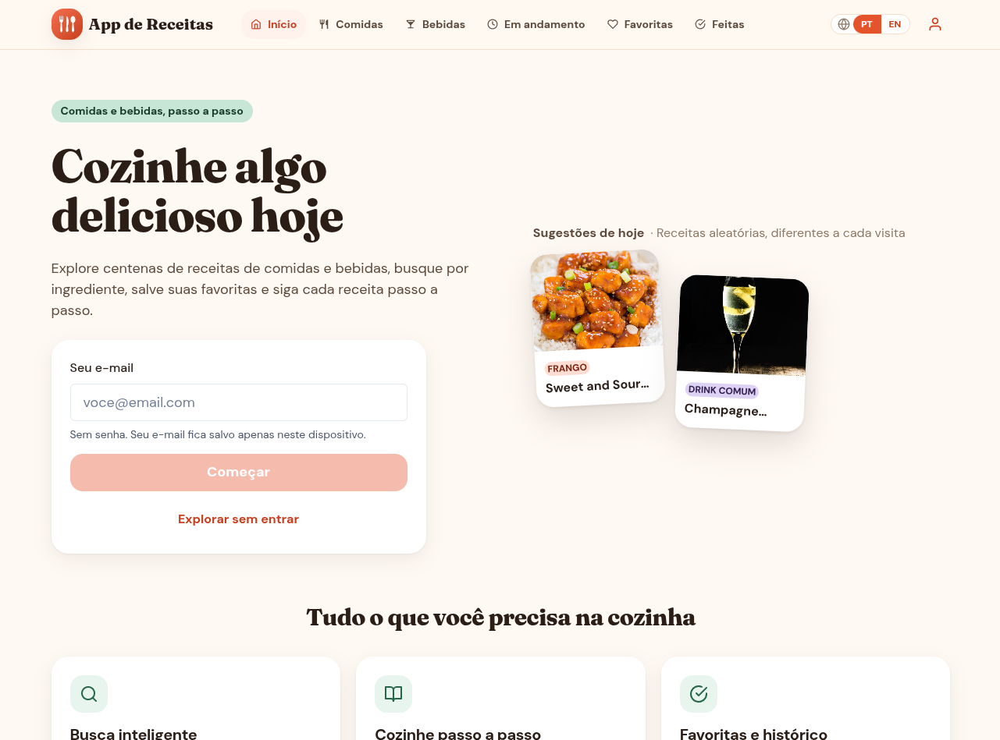
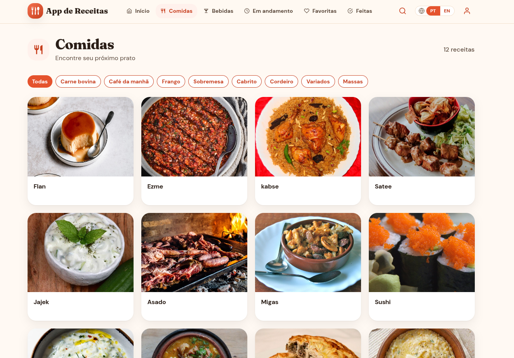
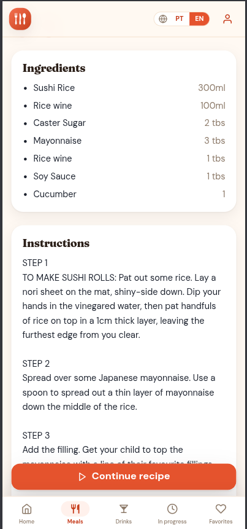
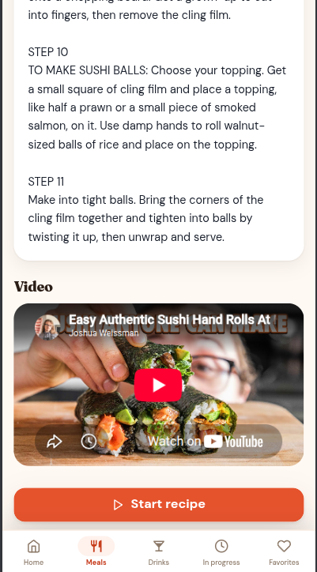
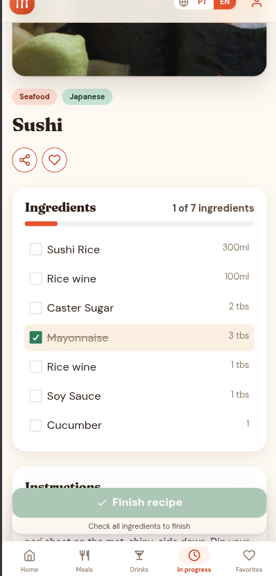
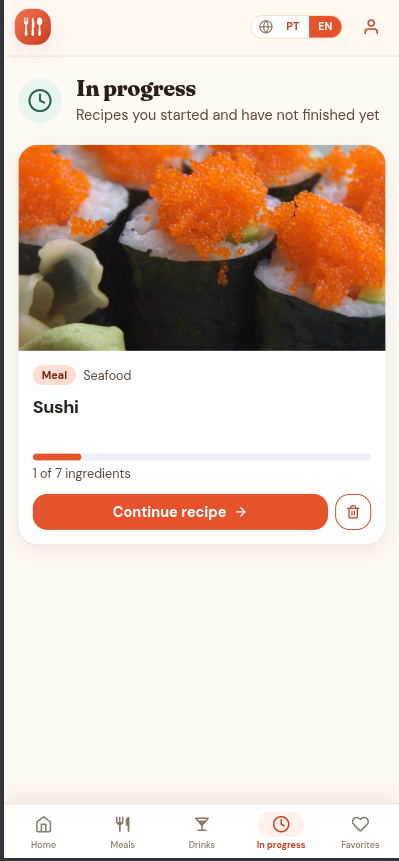

# 🍽️ Recipes App

A responsive recipe discovery and tracking app built to help users explore meals and drinks, save favorites, and follow recipes step by step from preparation to completion.

Live demo: https://devgabrielav.github.io/recipes-app/

## 🔎 Project overview

This application was created to make recipe discovery simple and practical. Users can browse a large collection of meals and drinks, filter by category or search by name or ingredient, review detailed instructions, and keep track of what they have already started or finished.

The experience is designed for everyday cooking use, with persistence across sessions so favorites, progress, and completed recipes remain available in the browser.

## ✨ Features

- Explore meals and drinks from public recipe APIs
- Search by name, ingredient, or first letter
- Filter by category
- View recipe details with ingredients, instructions, and images
- Save favorites
- Start recipes and mark ingredients as completed
- Resume in-progress recipes later
- Mark recipes as done
- View saved favorites, in-progress, and completed lists
- Switch between English and Portuguese
- Share recipes with a link
- Fall back to cached or local sample data when the API is unavailable

## 🧰 Tech stack

### Frontend
- React
- TypeScript
- Vite
- Chakra UI
- React Router DOM
- Context API
- Local Storage

### Backend and data
- TheMealDB API
- TheCocktailDB API
- Custom API helper layer with retries, caching, and offline fallback logic

### Testing and quality
- Vitest
- Testing Library
- Jest DOM
- ESLint

## 📁 Project structure

```text
src/
├── App.tsx
├── main.tsx
├── theme.ts
├── components/
├── context/
├── helper/
├── hooks/
├── i18n/
├── pages/
├── tests/
└── utils/
```

## 🚀 Getting started

### Prerequisites

- Node.js 18 or later
- npm

### Install dependencies

```bash
npm install
```

### Run the app locally

```bash
npm run dev
```

Then open:

```text
http://localhost:3000
```

## 🛡️ API resilience

The app includes fallback logic to keep the interface usable even when external recipe services are slow or unavailable. It uses timeout handling, retry attempts, cached responses, and local sample data to reduce failures and keep the user experience smooth.

## 📸 Screenshots

Desktop

<p align="center">
  
</p>
<p align="center">
  
</p>

Features

<table>
  <tr>
    <td align="center" width="50%">
      
    </td>
    <td align="center" width="50%">
      
    </td>
  </tr>
</table>
<table>
<td  align="center">
  
</td >
<td  align="center">
  
</td >
</table>

## 📝 Notes

This project is a frontend application focused on usability, recipe browsing, and persistence. It is meant to be a practical example of a responsive recipe app with offline-friendly behavior and a clean user flow.
